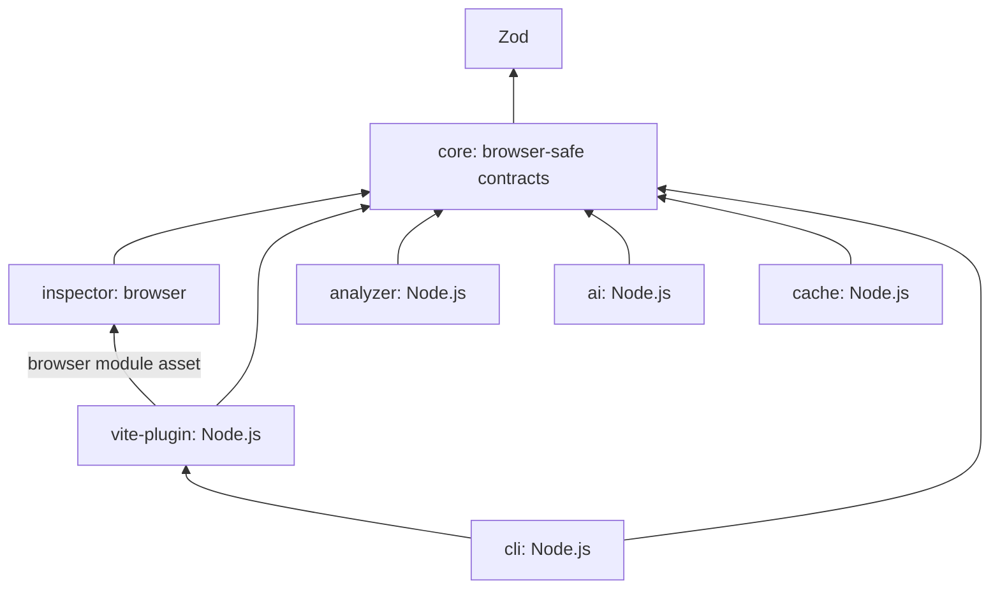

# DevAnalyst architecture

**React + Vite + TypeScript is the only currently supported framework combination.** The permanent [scope rule](../AGENTS.md) and [ADR 0003](adr/0003-react-vite-scope.md) supersede earlier multi-framework plans. All required product capabilities remain in scope for React + Vite.

## Active package boundaries

| Package                   | Responsibility                                          | Current implementation                                                                             |
| ------------------------- | ------------------------------------------------------- | -------------------------------------------------------------------------------------------------- |
| `@devanalyst/core`        | Browser-safe contracts and validation                   | Configuration, evidence/findings, events, errors, structured logging                               |
| `@devanalyst/vite-plugin` | Development-only Vite lifecycle and local Node services | Runtime injection, authenticated bridge, watcher events, lifecycle/port/error handling             |
| `@devanalyst/inspector`   | React browser UI and browser interactions               | Browser route/connection runtime implemented; inspector UI/options remain separate future work     |
| `@devanalyst/analyzer`    | Deterministic React/TypeScript AST analysis             | Request/analyzer interfaces only                                                                   |
| `@devanalyst/ai`          | Claude Code CLI execution and contextual explanations   | Provider/request interfaces only                                                                   |
| `@devanalyst/cache`       | Persistent analysis storage and invalidation            | Lookup/lifecycle interfaces only                                                                   |
| `@devanalyst/cli`         | Developer commands                                      | Help/version, dev startup/shutdown, and doctor diagnostics; editor/config utilities remain pending |

The only active playground is `apps/playground-react`. Its Vite configuration registers DevAnalyst and automatically injects the browser bridge during development. The React counter remains a host behavior fixture; source mapping and full inspector integration are future work. Retained historical artifacts are inventoried in [progress](progress.md) and excluded from this active architecture.

These arrows describe active package dependencies. Vite serves the inspector runtime asset without executing browser code in Node. Future composition may wire analyzer, AI, and cache implementations; no additional bridge or adapter package is justified. Do not introduce a generic framework adapter layer or empty future integrations.

## Phase 02 local bridge

The Vite plugin applies only to development serve, with final resolved production checks. It injects a small same-origin module, registers guarded bootstrap/module middleware, starts a separate loopback WebSocket server asynchronously after the host starts listening, and subscribes to allowed file changes. It does not return analysis work from startup or HMR hooks.

A fresh 256-bit token is returned through a no-store bootstrap response and offered as a WebSocket subprotocol credential. Upgrade checks require a loopback network peer, allowed Vite Origin, exact bridge Host/path, and constant-time token verification. Only the public protocol is negotiated. No credentials appear in URLs, HTML, shipped module source, logs, public snapshots, or persistence. There is no browser file-read or shell RPC.

The browser reports pathname and supported hash-route path from initial state, pushState, replaceState, popstate, and hashchange. It omits query strings, opaque fragments, history state, and input values. Node keeps per-connection route snapshots in memory and acknowledges validated updates. Routes are browser metadata, not verified source behavior and not terminal-log inference.

Reconnection uses bounded backoff/jitter and refetches bootstrap for rotated tokens/ports. Page suspension/resumption, offline failure, explicit stop, owned-history restoration, heartbeat, frame/rate/connection/buffer limits, and bounded source-event queues protect the host workflow. Vite restarts may configure a replacement before the predecessor closes, so cleanup is generation-specific. See [ADR 0004](adr/0004-vite-local-bridge.md).

Current transport supports standalone local HTTP Vite 8.3.5+; HTTPS and middleware mode report unsupported-feature diagnostics without failing the host. CSP must allow the selected loopback WebSocket port. This is an explicit current limitation, not a claim that all React + Vite product requirements are complete.

## Browser and Node.js separation

The planned React inspector owns delegated pointer/keyboard interactions, route/element metadata, highlights, translation display, and floating evidence UI. Use Shadow DOM isolation where appropriate, preserve application text/events, avoid sensitive inputs, and support scrolling, resizing, SPA navigation, HMR, loading/error states, and themes.

Node.js owns workspace-contained source reads, AST analysis, subprocesses, scheduling, persistent SQLite caching, and editor-opening controls. The Vite Plugin API owns automatic development-only startup and shutdown. Browser packages must not import Node.js modules or Node-only workspace packages. Validate messages and authorized workspace access before dispatching work.

## React mapping and deterministic analysis

Use development-time JSX/TSX instrumentation and stable public APIs to map DOM elements to source. Preserve source maps and application behavior. Cover nested components, conditional branches, lists, lazy-loaded components, HMR, and accessible shadow roots; report ambiguous or unsupported mappings explicitly. CSS selectors are not unique source identifiers, and private React internals cannot be the sole mapping mechanism.

Deterministic React/TypeScript analysis establishes component identity, props, render conditions, handlers/callback chains, hooks/state changes, imports/dependencies, API calls, and navigation, including React Router where applicable. Static relationships can be verified without proving runtime execution. Unsupported dynamic patterns require explicit uncertainty and actionable errors.

Each significant finding includes type, explanation, confidence, source evidence when available, analysis timestamp, and cache status. Use `UNKNOWN` when evidence is unavailable. Stale results cannot claim verified current behavior. Schema validation alone does not verify source facts.

## Claude Code CLI, pre-analysis, and cache

Claude Code CLI remains the primary AI integration for complex explanations, Japanese-to-Vietnamese translation, call-chain summaries, and follow-up questions. AI access is opt-in with explicit permitted paths and disclosure of provider transmission. Enforce read-only execution through runtime controls, not prompts alone. Detect installation/authentication/quota failures; use supported non-interactive invocation without shell interpolation, validate output, and support cancellation/timeouts.

Route-aware pre-analysis identifies relevant React sources, runs deterministic analysis, prioritizes selected/hovered/visible interactive elements, queues eligible AI work, and streams incremental results. Deduplicate requests, bound depth/concurrency/queue/memory, cancel obsolete work, and keep rendering/HMR responsive. Do not invoke Claude on every hover or scan the repository by default.

Layered caches cover pages, components, elements, translations, and mapping. Keys account for project/route, source/dependency hashes, schema, provider/model, language, and runtime context where needed. Require targeted source-change invalidation, stale-while-revalidate with stale labels, migrations, corruption recovery, size limits, and no persisted sensitive runtime values. Measure the cached-response target below 100 ms under documented conditions.

## Build and contract conventions

Libraries currently use ESM exports and TypeScript project references, emitting declarations and source maps. Relative TypeScript imports use `.js`; internal dependencies use `workspace:*`. Shared TypeScript settings retain strict checking, exact optional properties, unchecked-index protection, and declaration checking.

Active non-core packages depend on core; Vite also depends on the browser runtime asset, and CLI ships with the matching Vite integration. Existing configuration, versioned events, error serialization, and structured logger are reusable foundation work. Syntactic path schemas alone are not filesystem isolation. Phase 02 adds internal Node workspace access with includes/excludes, canonical containment, symlink/identity/change checks, and bounded reads. This does not implement an AI subprocess sandbox or expose those reads over the bridge.

Workspace globs, lockfile importers, scripts, TypeScript references, lint/test/package checks, and CI now select only the seven active packages and React fixture. Historical source/tests remain preserved and excluded. Use [testing](testing.md) for current commands and [progress](progress.md) for retained inventory.

## Production and release acceptance

Phase 02 tests verify that actual Vite/React production builds exclude browser runtime injection, bridge endpoints/credentials, and leaked local paths. Future inspector and AI implementation must preserve production exclusion. DevAnalyst failures must not crash or block the host app. Require keyboard/accessibility coverage, editor navigation to VS Code/Cursor, configuration/diagnostics, privacy controls, error recovery, and measured performance.

The [implementation plan](implementation-plan.md) and its Definition of Done cover every required feature. React + Vite product completion requires working runtime features, integration/E2E evidence, documentation, and NPM release preparation. Scope ownership, licensing, and release policy remain pending; no automatic publication is authorized.

## Future Roadmap

Next.js, Vue, Nuxt, Angular, Svelte, and other framework support is deferred. No generic adapter infrastructure, packages, playgrounds, dependencies, or tests for those frameworks belong in active phases. Consider expansion only after full React + Vite delivery and an explicit owner-approved scope change.
