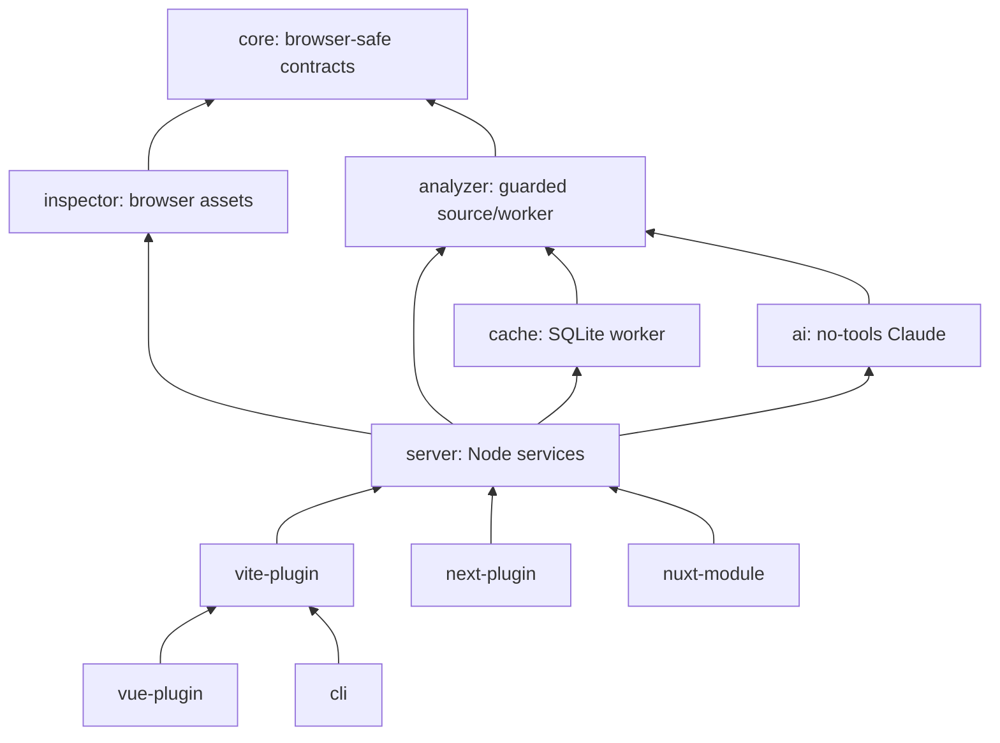

# DevAnalyst architecture

The [floating analysis switch](adr/0016-floating-analysis-toggle.md) coordinates browser inspection and tab-owned analysis through the existing bridge lifecycle. Off releases DOM observation/selection, cancels/disconnects that client's work and stops its page collector; on reboots the collector and authenticated connection for the current route. Browser lifecycle suspension remains independent of the user's enabled state.

The owner-requested [element flow summary](adr/0015-element-flow-summary.md) keeps translation and selected rendering/value/event outcomes in the primary inspector view, with full evidence in collapsed details. Bounded lexical display-source findings share the existing analyzer/worker/cache contracts; handler guards remain separate from rendering guards. See [UI behavior and limits](inspector-ui.md).

Phase 11 explicitly adds Next.js + React, Vue 3 + Vite and Nuxt 4 alongside React + Vite. [ADR 0013](adr/0013-framework-adapters.md) supersedes the prior React-only rule for these targets. Support remains bounded by the [verified framework guide](frameworks.md).

## Active package boundaries

| Package                   | Responsibility                                                                                                                                    |
| ------------------------- | ------------------------------------------------------------------------------------------------------------------------------------------------- |
| `@devanalyst/core`        | Browser-safe contracts, validation, framework IDs/capabilities, evidence and logging                                                              |
| `@devanalyst/inspector`   | Shared native browser UI/route runtime, neutral origin registry, public Vue directive entry                                                       |
| `@devanalyst/analyzer`    | Guarded source reads, concrete FrameworkAdapter contract, independent JSX/SFC mapping and bounded source analysis                                 |
| `@devanalyst/server`      | Actual development host contract, authenticated bridge, mapping registry, queue, selected analysis, Claude/cache/editor/configuration composition |
| `@devanalyst/vite-plugin` | Real Vite lifecycle/HTML/transforms/watchers and compatibility reexports                                                                          |
| `@devanalyst/vue-plugin`  | Vue strategy selection on the Vite host                                                                                                           |
| `@devanalyst/next-plugin` | Public Next dev server and Webpack/Turbopack loader integration, client bootstrap                                                                 |
| `@devanalyst/nuxt-module` | Public Nuxt module/Vite/listen/page lifecycle integration                                                                                         |
| `@devanalyst/ai`          | Opt-in enforced read-only Claude CLI and guarded original evidence context                                                                        |
| `@devanalyst/cache`       | Worker-owned SQLite, framework/policy/hash identity, invalidation                                                                                 |
| `@devanalyst/cli`         | Setup/doctor/status/dev/cache/analyze/open; dev/project doctor remain Vite-specific                                                               |

Active applications are `playground-react`, `playground-next`, `playground-vue` and `playground-nuxt`. Other historical tests remain excluded. All Node integrations supply real host middleware, bound HTTP server, source watchers and teardown through `DevelopmentHost`; no fake Vite object or private browser framework runtime is used.

Source adapters are pure bounded compiler functions. React public-ref mapping stays separate from Vue compiler-template/public-directive mapping. Vue uses original SFC positions/hashes; a UTF-16-preserving script projection feeds only common TypeScript import/call analysis. Template identities merge by module/revision while each committed DOM instance retains its own runtime ID. HMR changes source manifests without changing Vue setup script code, preserving template-only state. Watcher notifications demote obsolete provenance through the shared authenticated protocol.

Next maps explicit client JSX only. Its compiler subprocesses ask an owner-only Unix socket for a revision-checked authorized transform, with strict request shape, connection/frame/work bounds and cleanup. This is not a browser source-read RPC. Public Next request handling owns native upgrades; DevAnalyst owns its separate authenticated bridge. Nuxt uses public Kit/Vite/server hooks and dev-only committed-page notification. Server Components, Server Actions and Nitro logic never acquire browser execution claims. Full limits and startup examples are in [frameworks](frameworks.md).

## Phase 02 local bridge

The Vite plugin applies only to development serve, with final resolved production checks. It injects a small same-origin module, registers guarded bootstrap/module middleware, starts a separate loopback WebSocket server asynchronously after the host starts listening, and subscribes to allowed file changes. It does not return analysis work from startup or HMR hooks.

Vite's client `resolveId`/`load` hooks also provide the two instrumented mapping runtime imports from explicit public inspector exports, including Vue's relative mapping import. This supplies real module code during Vite pre-transformation, which bypasses HTTP middleware; a local URL marked external alone is insufficient. Existing runtime URLs, base paths and guarded HTTP serving remain unchanged. SSR, disabled integrations and production do not use this loader.

A fresh 256-bit token is returned through a no-store bootstrap response and offered as a WebSocket subprotocol credential. Upgrade checks require a loopback network peer, allowed Vite Origin, exact bridge Host/path, and constant-time token verification. Only the public protocol is negotiated. No credentials appear in URLs, HTML, shipped module source, logs, public snapshots, or persistence. There is no browser file-read or shell RPC.

The browser reports pathname and supported hash-route path from initial state, pushState, replaceState, popstate, and hashchange. It omits query strings, opaque fragments, history state, and input values. Node keeps per-connection route snapshots in memory and acknowledges validated updates. Routes are browser metadata, not verified source behavior and not terminal-log inference.

Reconnection uses bounded backoff/jitter and refetches bootstrap for rotated tokens/ports. Page suspension/resumption, offline failure, explicit stop, owned-history restoration, heartbeat, frame/rate/connection/buffer limits, and bounded source-event queues protect the host workflow. Vite restarts may configure a replacement before the predecessor closes, so cleanup is generation-specific. See [ADR 0004](adr/0004-vite-local-bridge.md).

Current transport supports standalone local HTTP Vite 8.3.5+; HTTPS and middleware mode report unsupported-feature diagnostics without failing the host. CSP must allow the selected loopback WebSocket port. This is an explicit current limitation, not a claim that all React + Vite product requirements are complete.

## Browser and Node.js separation

The browser inspector owns delegated pointer/keyboard interactions, local DOM metadata, client-rectangle highlights and a floating panel inside Shadow DOM. Initial hover previews are click-through; deliberate panel entry enables controls and holds the selection for scrolling and text selection ([ADR 0014](adr/0014-interactive-hover-and-commerce-playgrounds.md)). Alt or explicit Inspect mode activates detailed inspection. It preserves application text and normal interactions, handles scrolling/resizing, SPA/HMR, loading/error/disconnected states and light/dark/system themes. [ADR 0005](adr/0005-browser-element-inspector.md) records the owner-requested delivery order and the native DOM/CSS UI exception to the proposed React/Tailwind stack.

DOM text stays in the browser; Phase 07 sends bounded structural metadata and verified JSX IDs to the authenticated local Node bridge. DOM metadata carries a timestamp, source status `VERIFIED` for current safe JSX provenance or `UNKNOWN` with a reason, and no persistent cache. Extraction is bounded, uses an attribute allowlist, skips values/editable/private/hidden contents and does not collect HTML or arbitrary URLs. Native associated-label text is a candidate, not a complete accessible-name implementation. Open shadow roots and accessible same-origin frames are observed within bounded discovery limits; parent-document load capture attaches loaded frame documents before their first interaction, while general subtree discovery remains debounced; cross-origin frames and closed roots remain opaque. Teardown restores listeners/timers/observers and removes only the inspector host. The panel shows source origin/range and lexical owner when available. The Node engine provides behavioral source facts; Phase 09 projects selected evidence and independent translation into compact/expanded inspector modes.

Node.js owns workspace-contained source reads, AST analysis, subprocesses, scheduling, persistent SQLite caching, and editor-opening controls. Each concrete framework integration owns automatic development-only startup and shutdown. Browser packages must not import Node.js modules or Node-only workspace packages. Validate messages and authorized workspace access before dispatching work.

## React mapping and deterministic analysis

Phase 04 implements original `.tsx`/`.jsx` instrumentation in the development client transform. The analyzer uses TypeScript AST and MagicString edits/source maps; Vite uses guarded workspace reads and refuses upstream-modified source. Supported intrinsic JSX receives a public ref callback that registers committed DOM nodes in a browser WeakMap. Keys, application refs, children, hooks and event expressions are preserved. No source attributes, selectors or Fiber fields are used. Existing refs, spreads, custom elements and opaque factories fail closed. [ADR 0006](adr/0006-react-source-mapping.md) defines the verified origin envelope and limitations.

Compiler records contain relative file/one-based range, lexical component evidence, stable module/component/element identifiers and a content revision. Runtime node IDs distinguish repeated rows without collecting business keys or props. HMR disposal/prune and generation-matched watcher invalidations mark stale source UNKNOWN, including syntax-error edits while old DOM remains visible. Local packages are eligible only within explicitly configured workspace includes. Source modules and browser registry/diagnostics have explicit size/count limits. Node exposes `api.getMappingDiagnostics()` without source text; the browser metadata snapshot carries the resolved mapping. See [Phase 04 validation](phase-04-validation.md).

Phase 05 adds `createStaticAnalyzer().analyzeDetailed()` and the existing `Finding[]` adapter. The engine reads a bounded authorized module graph, uses a closed in-memory TypeScript host for configuration/resolution/binding, and emits source facts for props/relationships, lexical guards, callbacks, hooks/state, navigation, fetch/Axios and effects. It executes no application/config code. Unknown targets remain unknown; static verified references never prove runtime execution. The shared Node workspace policy now lives in analyzer, with a compatibility re-export in Vite, avoiding circular dependencies. Source policy, graph/trace limits, explicit aliases, JSONC config handling, source hashes and diagnostics are detailed in [ADR 0007](adr/0007-static-analysis-engine.md) and the [API guide](static-analysis.md).

The standalone Phase 05 API does not dispatch browser analysis RPCs. Phase 07 adds bounded structural indexing messages and schedules analysis in worker threads; hover/startup/HMR never await AST work. The existing source mapping and React behavior are preserved. Source/graph results remain local unless a caller explicitly enables and invokes the Phase 06 provider with permitted paths. Phase 09 adds selected result presentation under the existing source and provider policies.

Each significant finding includes type, explanation, confidence, source evidence when available, analysis timestamp, and cache status. Use `UNKNOWN` when evidence is unavailable. Stale results cannot claim verified current behavior. Schema validation alone does not verify source facts.

## Claude Code CLI, pre-analysis, and cache

Claude Code CLI remains the primary AI integration for complex explanations, Japanese-to-Vietnamese translation, call-chain summaries, and follow-up questions. AI access is opt-in with explicit permitted paths and disclosure of provider transmission. Enforce read-only execution through runtime controls, not prompts alone. Detect installation/authentication/quota failures; use supported non-interactive invocation without shell interpolation, validate output, and support cancellation/timeouts.

Phase 06 implements `createClaudeCodeProvider` in the existing AI package. A fixed native CLI 2.1.323 policy runs in an isolated temporary cwd with argument arrays, an environment allowlist, safe/restricted mode, no shell/file tools, strict empty MCP and disabled customizations. It accepts only schema-return StructuredOutput capability, validates stream metadata and strict Vietnamese payloads, resolves citations to real AST evidence and caps model prose at INFERRED. Context is reread through the shared workspace policy with AI consent intersection, canonical exclusions, hashes/ranges and secret checks. Process groups, bounded concurrency/queues, output/context/token budgets, cancellation, deadlines and transient-only retries protect lifecycle work. See [ADR 0008](adr/0008-claude-code-provider.md) for the trusted CLI/admin boundary and [usage](claude-code.md) for transmission/compatibility controls. Auth status alone does not prove inference/SDK entitlement; the local native CLI currently reports unavailable authentication. No browser AI RPC is added. Phase 07 additionally permits automatic source transmission only with `preanalysis.backgroundAI: true` and the existing enabled/path consent.

Phase 07 implements route-aware pre-analysis; see [ADR 0009](adr/0009-predictive-page-preanalysis.md) and [usage](preanalysis.md). A sliced browser collector and authenticated structural protocol feed a bounded, deduplicating module queue. Cancellable AST workers isolate CPU work from Vite; guarded dependency hashes validate per-server memory reuse. Node snapshots expose components/related files; browser/inspector expose progressive statuses. Optional source-backed Claude uncertainty jobs retain Phase 06 controls and need separate background consent. Phase 08 supplies persistent SQLite beneath memory reuse.

Route-aware pre-analysis identifies relevant React sources, runs deterministic analysis, prioritizes selected/hovered/visible interactive elements, queues eligible AI work, and streams incremental results. Deduplicate requests, bound depth/concurrency/queue/memory, cancel obsolete work, and keep rendering/HMR responsive. Do not invoke Claude on every hover or scan the repository by default.

Layered caches cover pages, components, elements, translations, and mapping. Keys account for project/route, source/dependency hashes, schema, provider/model, language, and runtime context where needed. Require targeted source-change invalidation, stale-while-revalidate with stale labels, migrations, corruption recovery, size limits, and no persisted sensitive runtime values. Measure the cached-response target below 100 ms under documented conditions.

## Phase 09 translation and inspector presentation

[ADR 0011](adr/0011-translation-and-inspector-ui.md) extends the native Shadow DOM UI without a framework migration. Separate browser client/panel modules receive closed progressive translation/analysis/AI updates. Node maps registered current JSX sites, projects bounded selected handler/call reachability and streams source facts before optional model explanations. AI prose is at most INFERRED; source declarations never prove execution. Inline evidence expands relative-file/range excerpts without an editor or file-read RPC.

Browser requests contain a text digest, never DOM text/values. Node-only bounded static JSX literal descriptors permit source-matched glossary/cache translation independently of AST work. Unknown terms can invoke a separate translator only on explicit expanded selection with configured AI/path consent. Hover uses glossary/cache/source facts and never starts new inference. Dynamic/private/control text remains local. Selected provider work retains Phase 06 controls; automatic background consent remains separate.

Independent worker-owned SQLite namespaces cache source-matched translation and selected source-only explanation with hashes/dependency topology, policy, model and schema identity. Browser historical reuse is UNKNOWN/stale until checked; source invalidation blocks late updates, cancels jobs and demotes old facts. Queue/message/item/memory/deadline bounds protect rendering and HMR. English/Vietnamese/Japanese chrome, system/light/dark themes, keyboard controls, copy/filter/search and viewport-bounded modes are described in [usage](inspector-ui.md). Only display preferences persist in browser storage; Node plugin cache clear also invalidates inspector memory. Phase 10 supplies guarded editor navigation; conversational follow-ups remain later work.

## Build and contract conventions

Libraries currently use ESM exports and TypeScript project references, emitting declarations and source maps. Relative TypeScript imports use `.js`; internal dependencies use `workspace:*`. Shared TypeScript settings retain strict checking, exact optional properties, unchecked-index protection, and declaration checking.

Phase 08 owns SQLite in a dedicated cache worker and injects persistence hooks into the analyzer queue without an analyzer-to-cache dependency cycle. Cache uses the lightweight public analyzer workspace export; Shared server services compose the cache and provider. Source hashes, missing candidates and canonical alias resolutions validate current results across restarts; stale historical findings are UNKNOWN and never attached as current evidence. See [ADR 0010](adr/0010-persistent-analysis-cache.md) and [usage](persistent-cache.md).

The server package composes runtime assets, analyzer, cache and AI; framework packages provide host lifecycle and mapping hooks. CLI ships with the matching Vite integration. Existing configuration, versioned events, error serialization, and structured logger are reusable foundation work. Syntactic path schemas alone are not filesystem isolation. Phase 02 adds internal Node workspace access with includes/excludes, canonical containment, symlink/identity/change checks, and bounded reads. This does not implement an AI subprocess sandbox or expose those reads over the bridge.

Workspace globs, lockfile importers, scripts, TypeScript references, lint/test/package checks and CI select eleven packages and four applications. Unrelated historical tests remain preserved and excluded. Use [testing](testing.md) for current commands and [progress](progress.md) for retained inventory.

## Production and release acceptance

Phase 02 tests verify that actual Vite/React production builds exclude browser runtime injection, bridge endpoints/credentials, and leaked local paths. Future inspector and AI implementation must preserve production exclusion. DevAnalyst failures must not crash or block the host app. Require keyboard/accessibility coverage, editor navigation to VS Code/Cursor, configuration/diagnostics, privacy controls, error recovery, and measured performance.

The [implementation plan](implementation-plan.md) and its Definition of Done cover every required feature. React + Vite product completion requires working runtime features, integration/E2E evidence, documentation, and NPM release preparation. Scope ownership, licensing, and release policy remain pending; no automatic publication is authorized.

## Future Roadmap

Angular, Svelte and further integrations remain outside the authorized scope. No subsequent phase or publication is implied.

## Interactive hover follow-up

[ADR 0014](adr/0014-interactive-hover-and-commerce-playgrounds.md) adds deliberate panel entry, a bounded target dwell/transfer corridor, pointer/focus hold, internal scrolling and viewport-constrained placement. Passive previews stay click-through; hover/focus do not start AI. Explicit selection/pinning and stale-source guards remain independent. Realistic [commerce playgrounds](playgrounds.md) provide actual local APIs and UI workflows within each native app, without new workspace packages or dependencies.
